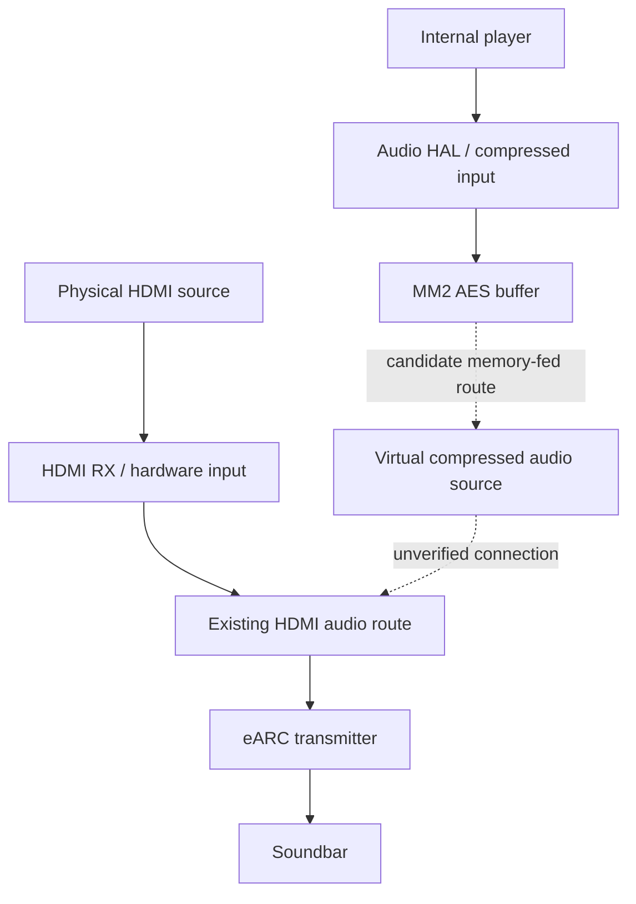

# Alternative transport: multimedia-fed virtual HDMI audio source

Status: research proposal, not implemented or runtime validated. Target TCL 65C9K / T653T01 / V670. Goal: real lossless TrueHD + Atmos from internal applications to eARC, without changing the video input or claiming Atmos merely from a status flag.

## Motivation and established evidence

- External HDMI Atmos and internal E-AC3 JOC are positive controls. The owner reports successful playback of TrueHD Atmos from a laptop over HDMI through the TV to the soundbar; the exact on-wire carrier has not been independently measured. Internal grouped TrueHD plays with normal sound but no Atmos indication; packed MAT attempts have failed.
- Android AudioClient and AudioPolicy, and the primary vendor HAL, contain format eligibility restrictions. The existing offline client/policy prototypes are not a functional transport.
- In the stock mtk-tvsnd-soc.ko, the two identified MAT bypass branches require HDMI_IN (2); MM_IN (4) does not set the bypass flag in those branches. Auto can instead select the MAT encoder. See [source predicates](mat-bypass-source-predicates.md).
- The host already has a compressed multimedia input path: LAPAF -> ALSA compressed input -> MM2 AES buffer -> R2 ES write-pointer notification. See [MM DSP input boundary](mm-dsp-input-boundary.md).
- The R2 MAT_HDMI_bypass parameter is a control-plane operation, not a data-plane transport. The existing eARC output configuration routines do not establish a host-writable dedicated non-PCM endpoint. See [output comparison](earc-output-and-recovery-gate.md).
- The exact DSP input mux, availability of a memory-fed bypass source, clock ownership and hardware restrictions are unresolved. Live kernel module byte identity remains unverified.

## Candidate architecture

Virtual HDMI here means an audio-only memory-fed source with an actual data path compatible with the existing transport. It does not mean pretending a physical HDMI port is connected, switching video input, falsifying EDID, defeating content protection, or changing a source enum without providing its required payload. The diagram is conceptual: it does not prove where the physical RX FIFO or DSP mux is implemented.

## Ordered alternatives

| Option | Approach | Dependency |
|---|---|---|
| A — preferred | Correct the existing MM decode/metadata/output path or integrate a supported non-PCM route in the HAL | DSP accepts appropriate MM input and preserves object metadata |
| B1 | Extend an existing memory-capable bypass route to MM input | Demonstrate a shared input mux or documented supported transport |
| B2 | Implement a distinct virtual compressed source with its own buffer lifecycle, connected to that route | Establish real DMA/buffer ownership, clock and non-PCM contracts |
| C | Dedicated memory-to-eARC compressed transmission path | Establish actual hardware/driver transport and legitimate access; may be unsupported |

A and B1 should be investigated before B2 or C. Do not simply force HDMI_IN, bypass/control bits, authorized Dolby profiles or Atmos status. Such changes would not prove that any audio data reaches the receiver.

## Investigation and acceptance gates

1. After read-only root preflight, confirm exact live driver and HAL hashes, module loading order, active processes, and mount/linker namespace visibility. Use an unchanged stock library overlay first if a supported Magisk setup and recovery are established.
2. Trace the physical HDMI source initialization and MM initialization, input mux, compressed buffer ownership, decoder selection, and output clock dependencies. Identify which paths carry data and which only configure/report state.
3. Check whether an available memory-fed input can actually drive the non-PCM output without executing an unsupported register write or assuming a PCM path is bit-preserving. If no supported route is established, obtain OEM clarification and stop the experimental transport design there.
4. A genuine implementation must preserve IEC61937/MAT framing (or a validated raw TrueHD contract), Atmos metadata, backpressure, timing and HW AV sync, negotiated eARC receiver capabilities, mute/flush/drain, and fallback on unplug, format change or unsupported output. It must not send compressed noise to speakers, headphones or ordinary PCM sinks.
5. Validate with the original Amaze sample and positive controls (HDMI and JOC), same sample hashes, observable decoder/output state, soundbar input-codec indication and normal A/V playback. Seek independent transport verification where possible; neither a forced flag nor successful write count proves Atmos.
6. Keep a removable, version-specific audio module separate from any privacy/debloat experiments. Kernel module replacements require kABI/CFI/signature and early-load review; stock recovery, verified boot implications and explicit owner approval are separate prerequisites.

No patch, bootloader operation, DSP change, or TV command is performed by this document. A virtual source is a fallback research hypothesis, not a promised solution to a possible hardware topology limitation.
